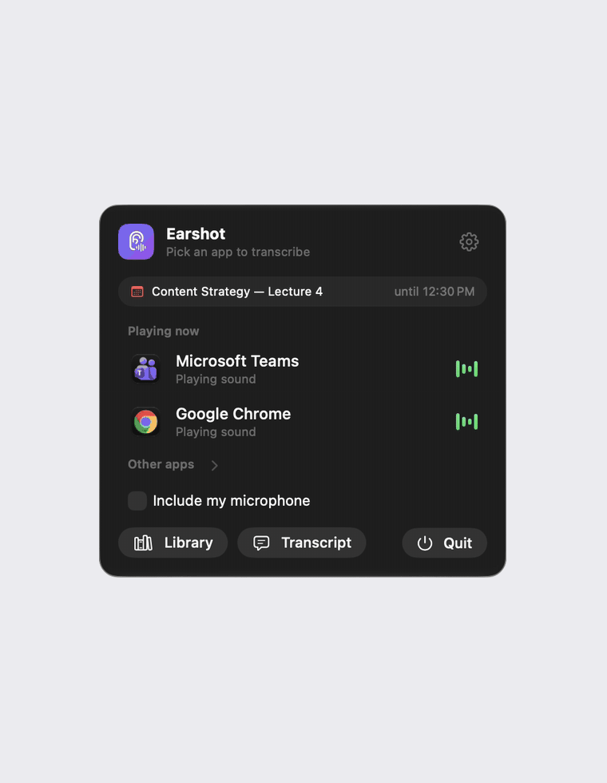

# Earshot

**[Download Earshot for Mac](https://github.com/Bouliw/earshot/releases/latest/download/Earshot.dmg)** · macOS 26 or later, Apple silicon

Live, on-device transcription of any app on your Mac, with speaker names.



Pick an app from the menu bar (Teams, Zoom, Chrome, Discord…) and everything it plays is transcribed as it is said. No cloud, no bot joining the call: audio never leaves the Mac.

## Features

- **One click.** The menu bar lists the apps playing sound right now. Click one to start.
- **Only that app.** Earshot taps the app's own audio output, so notifications, music or your own mic never end up in the transcript unless you ask. It works with the Mac muted.
- **Live text.** Lines appear a moment after they are spoken, and the sentence in progress writes itself out. Scroll up and the view stays put until you jump back to live.
- **Your voice too, if you want.** Tick "Include my microphone" and what you say is transcribed under your name. The mic is muted while the app is talking, so speaker echo is not transcribed twice.
- **Live subtitles, if you want.** Turn them on in Settings and a small translucent window shows the last two lines said, with the speaker's name when Earshot knows it. Drag it anywhere, change the text size from the window itself. Two engines: **Fast**, Apple's on-device recognition (nothing to download, one language at a time), or **High**, Kyutai STT 1B on MLX (French and English mixed, about half a second behind, 2.4 GB downloaded only when you click Install).
- **Who said what.** In Microsoft Teams, names come from Teams' own live captions, read through the accessibility API. Earshot can turn the captions on for you.
- **Filed by calendar event.** Each session is saved under the name of the calendar event it belongs to, then the date. Recording stops when the call ends, but not during a break before the event is over.
- **English or French.** The interface follows the system language, or pick one in Settings. Transcription works in either language, or detects it.
- **Exports.** Every session folder holds `Transcript.txt` and `Audio.m4a`, kept up to date while recording. Markdown and subtitles (.srt) export from the Library.
- **Searchable with your documents.** One plain text file per session, so a folder indexer such as [doc-indexer-macos](https://github.com/Bouliw/doc-indexer-macos) finds every class once, next to your other files. Neither app needs the other.

## How it works

| Piece | What it uses |
| --- | --- |
| Per-app capture | Core Audio process taps (`CATapDescription`, macOS 14.2+) on all of the app's audio processes, helpers included |
| Transcription | [whisper.cpp](https://github.com/ggml-org/whisper.cpp) with Metal. Audio is cut at pauses, silence is skipped so Whisper does not hallucinate |
| Speaker names | Teams' "Live Captions" panel, read through `AXUIElement`; each line takes the name most heard over its time span |
| Calendar | EventKit |
| Live subtitles | Fast: Apple's `SpeechAnalyzer`. High: [Kyutai STT 1B en_fr](https://huggingface.co/kyutai/stt-1b-en_fr-mlx) with MLX, run by a small Python script in its own environment |

## Install

1. [Download `Earshot.dmg`](https://github.com/Bouliw/earshot/releases/latest/download/Earshot.dmg), open it and drag Earshot onto the Applications folder.
2. Get a Whisper model in ggml format (once). Earshot looks in `~/Library/Application Support/Earshot/Models` and `~/.cache/whisper-cpp`. `ggml-large-v3-turbo.bin` (1.6 GB) is a good default:

   ```bash
   mkdir -p ~/Library/Application\ Support/Earshot/Models
   curl -L -o ~/Library/Application\ Support/Earshot/Models/ggml-large-v3-turbo.bin https://huggingface.co/ggerganov/whisper.cpp/resolve/main/ggml-large-v3-turbo.bin
   ```

3. Open Earshot from Applications. It is not notarized by Apple, so the first time macOS refuses to open it:
   - In the "Earshot.app" Not Opened message, click **Done**.
   - Open **System Settings › Privacy & Security**, scroll down to **Security** and click **Open Anyway** next to "Earshot.app" was blocked to protect your Mac.
   - Click **Open Anyway** again and confirm with your password or Touch ID.

   From then on it opens normally. Earshot lives in the menu bar (an ear icon), not in the Dock.

### Permissions

macOS asks for each permission the first time Earshot needs it:

| Permission | When | What for |
| --- | --- | --- |
| System Audio Recording | First transcription | Hearing the app you pick. Required |
| Calendars | First time you open the menu | Naming and filing sessions after the calendar event |
| Device Control and Data Access (Accessibility before macOS 27) | First Teams call | Reading Teams live captions for speaker names. Turn Earshot on in System Settings › Privacy & Security › Device Control and Data Access |
| Microphone | Only if you tick "Include my microphone" | Transcribing your own voice |

Earshot works without the optional ones: sessions are then named after the app, and lines have no speaker names.

### High subtitles

Settings › Live subtitles › High › **Install** downloads 2.4 GB after asking: the model from Hugging Face (pinned revision, checked against its SHA-256) and its Python packages. It needs Python 3.10, 3.11 or 3.12 (from python.org or Homebrew) and goes into `~/Library/Application Support/Earshot/Kyutai`; delete that folder to remove it.

### Search your classes with your documents

Save sessions inside a folder you index, then search transcripts and documents together. With doc-indexer:

```bash
python3 extract_texts.py ~/Documents/School      # Earshot saves into ~/Documents/School/Recordings
grep -ril "engagement" ~/Documents/School/.doc-index
```

## Build

Only the Command Line Tools are needed (no Xcode project):

```bash
scripts/build.sh --install
```

This builds `build/Earshot.app` and copies it to `/Applications`. `scripts/build.sh --dmg` makes `build/Earshot.dmg` instead.

If an Apple Development certificate is in your keychain (a free Apple Account added in Xcode › Settings › Apple Accounts is enough), local builds are signed with it, so macOS keeps Earshot's permissions across rebuilds. Without one, builds are signed ad hoc and macOS treats every rebuild as a new app: remove Earshot from Device Control and Data Access and add it again. Set `EARSHOT_SIGN_IDENTITY` to choose a specific identity. DMGs are always signed ad hoc.

To check the pipeline on an audio file without a call (the transcript, then the live subtitles):

```bash
build/Earshot.app/Contents/MacOS/Earshot --transcribe some-recording.wav
build/Earshot.app/Contents/MacOS/Earshot --subtitles some-recording.wav kyutai
```

## License

MIT
