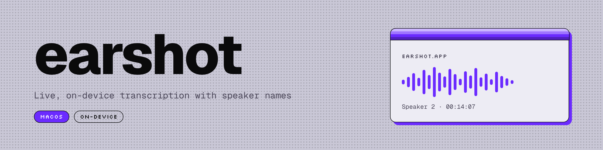
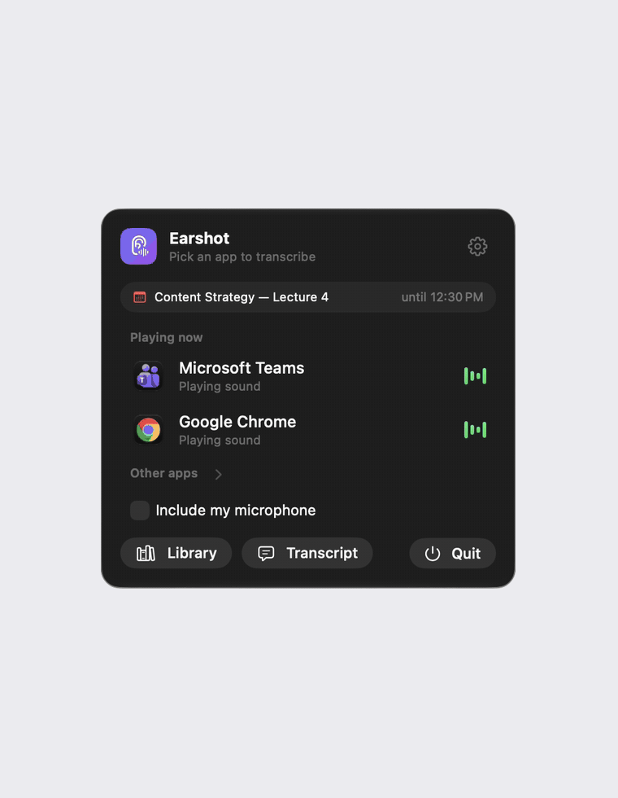

<picture>
  <source media="(prefers-color-scheme: dark)" srcset="docs/banner-dark.png">
  
</picture>

# Earshot

[](https://github.com/Bouliw/earshot/actions/workflows/tests.yml)

**[Download Earshot for Mac](https://github.com/Bouliw/earshot/releases/latest/download/Earshot.dmg)** · macOS 26 or later, Apple silicon<br>
**Earshot for Windows:** [x64](https://github.com/Bouliw/earshot/releases/latest/download/Earshot-Windows-x64.zip) · [Arm64](https://github.com/Bouliw/earshot/releases/latest/download/Earshot-Windows-arm64.zip) · Windows 10 or 11, after the call only ([details](#earshot-for-windows))

On-device transcription of any app on your Mac, live or once the call is over, with each voice told apart.



Pick an app from the menu bar (Teams, Zoom, Chrome, Discord…) and everything it plays is transcribed, either once the call is over or as it is said. No cloud, no bot joining the call: audio never leaves the Mac.

## Features

- **One click.** The menu bar lists the apps playing sound right now. Click one to start.
- **After the call, or live.** By default only the sound is saved during the call: no model runs, so the Mac stays cool, and the transcript is written once the call ends. Transcripts waiting for their turn also hold off while another recording runs. Switch to **Live** in the menu to watch the text appear as it is said, before or during a call: switching mid-call keeps one session, and whatever was not transcribed live is written from the audio at the end.
- **Each voice told apart.** Once the call ends, Earshot works out who spoke when, on the Neural Engine. Lines get the Teams names when it can see them, "Speaker 1", "Speaker 2"… otherwise. Click a name to rename that speaker everywhere in the session; give two the same name to merge them.
- **A summary after each call.** Once the transcript is written, Apple's on-device model (Apple Intelligence) writes a short summary in the language of the call: what it was about, the key points, the decisions and who does what. It shows above the transcript and is saved as `Summary.txt` next to it. **Summarize again** rewrites it; turn it off in Settings. A long class is read in blocks, then the notes are merged.
- **Files too.** "Transcribe a file…" (or a drop on the Library) takes any audio or video file macOS can open: a voice memo, a meeting recorded elsewhere. Each one is transcribed like a call, voices included.
- **Only that app.** Earshot taps the app's own audio output, so notifications, music or your own mic never end up in the transcript unless you ask. It works with the Mac muted.
- **Live text.** Lines appear a moment after they are spoken, and the sentence in progress writes itself out. Scroll up and the view stays put until you jump back to live.
- **Your voice too, if you want.** Tick "Include my microphone" and what you say is transcribed under your name, even when you talk over the other side. With speakers, the microphone also hears the call: Earshot takes the app's sound back out of it (echo cancellation) instead of muting it, so the echo is not transcribed twice and your interruptions are not lost.
- **Live subtitles, if you want.** One click turns them on or off: **Subtitles** in the transcript window, next to Stop, or the checkbox in the menu before the call. A small translucent window shows the last two lines said, with the speaker's name when Earshot knows it. Drag it anywhere, change the text size from the window itself. Two engines: **Fast**, Apple's on-device recognition (nothing to download, one language at a time), or **High**, Kyutai STT 1B on MLX (French and English mixed, about half a second behind, 2.4 GB downloaded only when you click Install).
- **Who said what.** In Microsoft Teams, names come from Teams' own live captions, read through the accessibility API. Earshot can turn the captions on for you.
- **Filed by calendar event.** Each session is saved under the name of the calendar event it belongs to, then the date. Recording stops when the call ends, but not during a break before the event is over.
- **English or French.** The interface follows the system language, or pick one in Settings. Transcription works in either language, or detects it. After the call, the language is detected for each piece of speech (one voice, up to 15 s), so a class that goes back and forth between French and English keeps each sentence in the language it was said in. Live, detection runs once per block of speech (up to 25 s): when speakers switch languages within a block, the transcript keeps the block's main language and sentences in the other one come out translated rather than word for word. The High live subtitles follow both languages as spoken.
- **Nothing lost.** The sound is written as it comes, so a forced quit, a crash or a Mac that shuts down mid-call loses only the last fraction of a second: Earshot picks the session up at its next launch.
- **Exports.** Every session folder holds `Transcript.txt` and `Audio.m4a`. Markdown and subtitles (.srt) export from the Library, and any session can be transcribed again from its audio.
- **Searchable with your documents.** Turn on "Index transcripts with doc-indexer" and Earshot runs [doc-indexer-macos](https://github.com/Bouliw/doc-indexer-macos) by itself after each transcript, so your calls and classes can be searched with your other files. It waits until no call is recorded and no transcript is being written, then runs at background priority: the Mac stays cool. Each session is one plain text file, so the indexer finds every class once.

## How it works

| Piece | What it uses |
| --- | --- |
| Per-app capture | Core Audio process taps (`CATapDescription`, macOS 14.2+) on all of the app's audio processes, helpers included |
| Transcription | [whisper.cpp](https://github.com/ggml-org/whisper.cpp) with Metal. Audio is cut at pauses, silence is skipped so Whisper does not hallucinate. After the call, Silero's voice activity model (Core ML, through FluidAudio) keeps only the stretches where someone speaks, so breathing, typing and room noise on the microphone do not turn into made-up lines. Each piece is one voice and gets its own language |
| Voices | [FluidAudio](https://github.com/FluidInference/FluidAudio)'s offline speaker diarization (pyannote segmentation and speaker embeddings in Core ML, on the Neural Engine). Each voice takes the Teams name heard most over its turns |
| Speaker names | Teams' "Live Captions" panel, read through `AXUIElement`, kept with the session so the voices can be named after the call |
| Summary | Apple's Foundation Models framework (the on-device model behind Apple Intelligence) |
| Calendar | EventKit |
| Live subtitles | Fast: Apple's `SpeechAnalyzer`. High: [Kyutai STT 1B en_fr](https://huggingface.co/kyutai/stt-1b-en_fr-mlx) with MLX, run by a small Python script in its own environment |

## Install

1. [Download `Earshot.dmg`](https://github.com/Bouliw/earshot/releases/latest/download/Earshot.dmg), open it and drag Earshot onto the Applications folder.
2. Get a Whisper model in ggml format (once). Earshot looks in `~/Library/Application Support/Earshot/Models` and `~/.cache/whisper-cpp`. `ggml-large-v3-turbo.bin` (1.6 GB) is a good default:

   ```bash
   mkdir -p ~/Library/Application\ Support/Earshot/Models
   curl -L -o ~/Library/Application\ Support/Earshot/Models/ggml-large-v3-turbo.bin https://huggingface.co/ggerganov/whisper.cpp/resolve/main/ggml-large-v3-turbo.bin
   ```

3. Open Earshot from Applications. It is not notarized by Apple, so the first time macOS refuses to open it:
   - In the "Earshot.app" Not Opened message, click **Done**.
   - Open **System Settings › Privacy & Security**, scroll down to **Security** and click **Open Anyway** next to "Earshot.app" was blocked to protect your Mac.
   - Click **Open Anyway** again and confirm with your password or Touch ID.

   From then on it opens normally. Earshot lives in the menu bar (an ear icon), not in the Dock.

### Permissions

macOS asks for each permission the first time Earshot needs it:

| Permission | When | What for |
| --- | --- | --- |
| System Audio Recording | First transcription | Hearing the app you pick. Required |
| Calendars | First time you open the menu | Naming and filing sessions after the calendar event |
| Device Control and Data Access (Accessibility before macOS 27) | First Teams call | Reading Teams live captions for speaker names. Turn Earshot on in System Settings › Privacy & Security › Device Control and Data Access |
| Microphone | Only if you tick "Include my microphone" | Transcribing your own voice |

Earshot works without the optional ones: sessions are then named after the app, and voices are numbered instead of named.

The first time voices are told apart, Earshot downloads the speaker models (about 40 MB, from Hugging Face) into `~/Library/Application Support/Earshot/Speakers`. The first transcript made after the call also downloads the voice activity model (about 1 MB) into `~/Library/Application Support/Earshot/Voice activity`; without it, Earshot falls back on the sound level. Turn "Tell voices apart" off in Settings to skip them. With the microphone included, the app and your voice are also kept as two hidden tracks until the transcript is done, so your voice is never taken for someone else's.

### High subtitles

Settings › Live subtitles › High › **Install** downloads 2.4 GB after asking: the model from Hugging Face (pinned revision, checked against its SHA-256) and its Python packages. It needs Python 3.10, 3.11 or 3.12 (from python.org or Homebrew) and goes into `~/Library/Application Support/Earshot/Kyutai`; delete that folder to remove it.

### Search your classes with your documents

1. Get [doc-indexer-macos](https://github.com/Bouliw/doc-indexer-macos) (a clone and one `swiftc` line, see its README).
2. In Settings › Search with your documents, turn on **Index transcripts with doc-indexer**. Earshot looks for `extract_texts.py` in the usual places (`~/doc-indexer-macos`, `~/Developer`, `~/Documents/GitHub`…) and asks for it otherwise.
3. **Folder to index** is the folder sessions are saved to. Pick a folder that holds it instead (say `~/Documents/School`, with sessions saved in `~/Documents/School/Recordings`) to search transcripts and documents together.

After each transcript, once no call is being recorded, Earshot runs doc-indexer on that folder at background priority. Settings show when it last ran, and **Index now** runs it right away. The texts land in the folder's hidden `.doc-index`, where transcripts have the type `transcript` in `_manifest.tsv`:

```bash
grep -ril "engagement" ~/Documents/School/.doc-index
```

## Build

Only the Command Line Tools are needed (no Xcode project):

```bash
scripts/build.sh --install
```

This builds `build/Earshot.app` and copies it to `/Applications`. `scripts/build.sh --dmg` makes `build/Earshot.dmg` instead.

If an Apple Development certificate is in your keychain (a free Apple Account added in Xcode › Settings › Apple Accounts is enough), local builds are signed with it, so macOS keeps Earshot's permissions across rebuilds. Without one, builds are signed ad hoc and macOS treats every rebuild as a new app: remove Earshot from Device Control and Data Access and add it again. Set `EARSHOT_SIGN_IDENTITY` to choose a specific identity. DMGs are always signed ad hoc.

Tests: `swift test`, then `build/Earshot.app/Contents/MacOS/Earshot --check` on the built app (it also checks the French strings).

To check the pipeline on an audio file without a call (the transcript, then the live subtitles):

```bash
build/Earshot.app/Contents/MacOS/Earshot --transcribe some-recording.wav
build/Earshot.app/Contents/MacOS/Earshot --subtitles some-recording.wav kyutai
```

## Earshot for Windows

A separate app in the same repository (`windows/`, C# and .NET 8), with the Mac's after-the-call pipeline: record the call, then get the transcript on the PC, each voice told apart. Sessions and transcripts use the same folders and formats as on the Mac.

[](https://github.com/Bouliw/earshot/actions/workflows/windows.yml)

### Download and run

1. Download the zip for your PC: [`Earshot-Windows-x64.zip`](https://github.com/Bouliw/earshot/releases/latest/download/Earshot-Windows-x64.zip) (Intel and AMD) or [`Earshot-Windows-arm64.zip`](https://github.com/Bouliw/earshot/releases/latest/download/Earshot-Windows-arm64.zip) (Snapdragon and other Arm PCs). **Settings › System › About › System type** tells which one you have.
2. Extract it anywhere and open `Earshot.exe` in the `Earshot` folder. It is not signed, so the first time SmartScreen may show "Windows protected your PC": click **More info**, then **Run anyway**.
3. Type a title for the session (or keep the suggested "Call" and the date), pick the microphone, click **Record**. Click **Stop** when the call is over: the transcript is written on the PC, and appears in the window when it is done.

### Requirements

- Windows 10 (1809 or later) or Windows 11, 64-bit, on x64 or Arm64. Nothing else to install: .NET and the Visual C++ runtime are in the zip.
- About 2 GB of disk for the default Whisper model (large-v3-turbo, 1.6 GB, and the voice models) and 2.5 GB for the default summary model; 8 GB of memory is enough for both. Everything runs on the CPU: on a slower or Arm PC, a lighter Whisper model (Large v3 Turbo compact, Small, Base) and a smaller summary model in Settings give the results sooner.

### How it works

- **Two tracks.** The PC's sound (whatever plays on the default output: Teams, Zoom, a browser…) is captured through WASAPI loopback, and the chosen microphone apart, both written to disk as they come. A session cut short (Earshot closed, PC shut down) is transcribed at the next launch.
- **Only where someone speaks.** Silero's voice activity model keeps the stretches with a voice on each track, so breathing, typing and room noise never reach Whisper. Whisper ([whisper.cpp](https://github.com/ggml-org/whisper.cpp) through [Whisper.net](https://github.com/sandrohanea/whisper.net)) detects the language of each piece, as on the Mac.
- **Each voice told apart.** On the PC's track, [sherpa-onnx](https://github.com/k2-fsa/sherpa-onnx) (pyannote segmentation and speaker embeddings) separates the voices: "Speaker 1", "Speaker 2"… Click a name to rename that speaker everywhere in the session; give two the same name to merge them. The microphone track is always you ("Me" by default, set in Settings). It is never muted: what comes out of laptop speakers is taken back out of it (echo cancellation, using the PC's track as the reference), so it is not transcribed twice, and what you say over the other side is kept.
- **A summary after each call.** Once the transcript is written, a language model on the PC ([Qwen3](https://huggingface.co/Qwen), run by llama.cpp through [LLamaSharp](https://github.com/SciSharp/LLamaSharp)) writes a short summary in the language of the call: what it was about, the key points, the decisions and who does what. It shows above the transcript and is saved as `Summary.txt`. Settings turn it off or pick the model: **Small** (1.8 GB), **Medium** (2.5 GB, the default), **Large** (5 GB) or **Extra large** (9 GB). A bigger model writes better summaries but takes longer and needs more memory; it is downloaded the first time it is used.
- **Files.** `Documents\Earshot\Calls\<title>\<date>\` holds `Audio.m4a` (AAC; `Audio.wav` on Windows editions without the AAC encoder), `Transcript.txt`, `Summary.txt` and `.earshot.json`, as on the Mac.
- **Models.** Downloaded the first time they are needed, with progress in the window, into `%LOCALAPPDATA%\Earshot\Models`; each file is checked against its expected size.
- **Out of the way.** Closing the window keeps Earshot in the notification area (start or stop a recording from its icon, right-click to quit). The interface follows the language of Windows, English or French.

### What differs from the Mac

- After the call only: no live mode and no live subtitles.
- No calendar: sessions are named after the title you type.
- No Teams names: voices are numbered, to rename by hand.
- The whole PC sound is recorded, not a single app: a notification or music playing during the call is in the recording too.
- No file import, doc-indexer indexing or Markdown and subtitle export yet.

### Build

The .NET 8 SDK is enough. The solution also builds on macOS and Linux (the app itself only runs on Windows):

```bash
dotnet test windows/tests/Earshot.Core.Tests
dotnet publish windows/src/Earshot.Windows -c Release -r win-x64 --self-contained -o out
```

To check the after-the-call pipeline on WAV files, on any system:

```bash
dotnet run --project windows/tools/Earshot.Check -- --check pc-sound.wav --mic microphone.wav
```

On Windows, `Earshot.exe --check recording.wav --out result.txt` does the same with the libraries of that install.

## License

MIT
